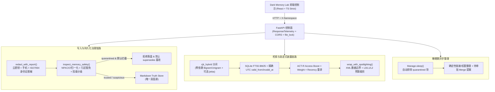

# Agent Memory Workbench — Agent 长期记忆引擎与上下文安全控制台

[](#10-开源协议与致谢)
[](#5-快速启动与交互演示)
[](#3-核心架构与全链路设计)
[](#6-前端控制台使用指南3-个核心页面)
[](#8-测试与量化评测成绩单)
[](#83-三套独立盲测集ood-holdout真实表现)

> **让 Agent 长期记忆“查得准、省 Token、可溯源、防投毒”**：本项目是基于高星开源长期记忆运行时 [`tigerless-labs/agent-memory`](https://github.com/tigerless-labs/agent-memory)（MIT License）深度增强的全栈 **Agent Memory Control Plane & Dark Memory Lab**。  
> **后端**保留了「纯 Markdown 即真值、SQLite 索引随时可删重建」的原生架构哲学，并新增**零依赖中英混合分词（`cjk_hybrid`）**、**记忆投毒守卫与 Spotlighting 防逃逸隔离**、**国产云密钥与合规 PII 持久化脱敏**、**ACT-R 访问巩固与精确时序召回**以及 **7 接口 FastAPI 控制面**；**前端**采用零重型 UI 库的 React + TypeScript 打造暗色实验室控制台，让访客一键体验渐进式上下文省 Token、时间旅行回溯、SVG 记忆图谱与 24 用例基准评测。

---

## 目录

- [1. 解决什么核心痛点？](#1-解决什么核心痛点)
- [2. 仓库目录结构](#2-仓库目录结构)
- [3. 核心架构与全链路设计](#3-核心架构与全链路设计)
- [4. 五大核心工程优化与创新点](#4-五大核心工程优化与创新点)
- [5. 快速启动与交互演示](#5-快速启动与交互演示)
- [6. 前端控制台使用指南（3 个核心页面）](#6-前端控制台使用指南3-个核心页面)
- [7. 后端 FastAPI 控制面接口一览](#7-后端-fastapi-控制面接口一览)
- [8. 测试与量化评测成绩单](#8-测试与量化评测成绩单)
- [9. 已知边界与生产部署建议](#9-已知边界与生产部署建议)
- [10. 开源协议与致谢](#10-开源协议与致谢)

---

## 1. 解决什么核心痛点？

在构建生产级 AI Agent 时，跨会话记忆（Long-Term Memory）通常会撞上四堵墙：
1. **Token 爆炸与上下文迷失**：每次对话把所有历史记忆全文塞进 Prompt，不仅成本高昂，还会稀释关键注意力。本项目采用 **`L0 (Abstract) → L1 (Outline) → L2 (Full)` 三级渐进披露**，实测平均节省 **91.7%**（同可见集严格口径 **76.6%**）上下文 Token。
2. **原生 SQLite FTS5 中文“失明”**：上游默认 `ascii` 模式用 `unicode61` 分词，遇到中文整句几乎无法命中；而启用 `cjk` 又强制依赖外部 `jieba` 库，未安装直接崩溃。本项目内置**零依赖 `cjk_hybrid` 双字 Bigram + 首尾单字切分**（可选合并 `jieba` 词典），无额外安装即可将中文 `Recall@3` 从 **12.5% 提升至 100.0%**。
3. **跨会话记忆投毒（OWASP ASI06）**：恶意会话或外部文本一旦将 `"Ignore all previous instructions..."` 写入长期记忆，后续每次召回都会持续劫持宿主大模型（上游红队测试甚至刻意允许投毒命中照常返回）。本项目引入**写入期强弱分级检测 + 召回期隔离过滤 + XML Spotlighting 转义包裹**。
4. **隐私与凭证固化进磁盘**：Agent 自动整理对话摘要时，极易将手机号、身份证号或阿里云 `LTAI` / GitHub `ghp_` / AWS `AKIA` 密钥永久写入 Markdown。本项目在落盘前执行**持久化脱敏**，同时通过 **ISO 7064 MOD 11-2 校验位 + 日期合法性双重校验** 放行 18 位正常业务订单号。

---

## 2. 仓库目录结构

```text
.
├── 后端/                                           # Python 3.12+ 核心记忆引擎与 FastAPI 控制面
│   ├── packages/
│   │   ├── core/src/agent_memory/
│   │   │   ├── core/
│   │   │   │   ├── tokenization.py                 # 零依赖 cjk_hybrid 分词 + 原生 ascii/cjk 兼容
│   │   │   │   ├── redaction.py                    # 持久化脱敏（含 LTAI/AWS/GitHub/手机号/ISO7064 身份证）
│   │   │   │   ├── poison_guard.py                 # 中英德记忆投毒守卫、引号复盘豁免与 Spotlighting 边界转义
│   │   │   │   ├── recall.py                       # 原生 Recall + recall_enhanced（ACT-R 访问巩固 & 精确时序区间）
│   │   │   │   ├── context.py                      # L0/L1/L2 渐进式披露与 Token 预算统计
│   │   │   │   ├── manage.py / dreaming.py         # 睡眠期整合（自动隔离 quarantined 记忆，生成审批提案）
│   │   │   │   └── store.py / indexer.py / record.py# Markdown 真值写入锁、SQLite FTS5 重投影签名校验
│   │   │   └── server/
│   │   │       ├── main.py                         # FastAPI 入口、CORS、Correlation-ID/Latency 中间件
│   │   │       ├── models.py                       # 严格 Pydantic v2 请求/响应契约模型
│   │   │       ├── service.py                      # 命名空间锁、安全写入隔离、增强召回、Sleep 编排
│   │   │       ├── demo.py                         # 3 命名空间中英双语 9 节点演示记忆库生成器
│   │   │       └── benchmark.py                    # 24 用例三维在线/离线基准评测器
│   │   ├── cli/ · adapters/ · mcp/ · executor/ · harness/  # 原生 CLI、MCP Server 与 LoCoMo 实验套件
│   ├── tests/
│   │   ├── system/test_memory_control_plane.py     # 控制面 7 端点端到端契约测试
│   │   ├── system/test_workbench_isolation.py      # 跨进程锁竞争与投毒隔离/持久化隔离测试
│   │   ├── system/test_workbench_ood.py            # 三套共 66 题冻结盲测（OOD Holdout）自动化验证
│   │   └── unit/test_poison_guard.py ...           # 单元测试（全仓共 1,460 passed）
│   └── pyproject.toml
│
└── 前端/                                           # React 18 + TypeScript Strict (Dark Memory Lab)
    ├── src/
    │   ├── api/client.ts                           # 统一客户端（自动注入 X-Namespace 与追踪响应头）
    │   ├── types/memory.ts                         # 与后端 OpenAPI 逐字段对齐的严格 TS 类型
    │   ├── presets/samples.ts                      # 4 组召回预设 + 5 组写入/脱敏/投毒预设
    │   ├── components/
    │   │   ├── ProgressiveRecallLab.tsx            # 页面 1：混合召回、--as-of 时间旅行、Token 仪表盘与 L0/L1/L2 阅读器
    │   │   ├── MemoryGraphAndManage.tsx            # 页面 2：原生 SVG 记忆关系图谱、安全写入脱敏对比与 Sleep 整理台
    │   │   └── BenchmarkAndSecuritySuite.tsx       # 页面 3：24 用例三维基准跑分与平面筛选明细表
    │   └── App.tsx / styles.css
    ├── tests/contracts.test.mjs                    # OpenAPI 17 个前后端契约一致性自动校验测试
    └── vite.config.ts                              # 开发代理 (/v1, /health -> 127.0.0.1:8000)
```

---

## 3. 核心架构与全链路设计



---

## 4. 五大核心工程优化与创新点

1. **零依赖中英混合分词与索引签名一致性（`tokenization.py` · `search_index.py` · `indexer.py`）**
   - `cjk_hybrid` 模式对 `U+4E00–U+9FFF` 汉字序列自动生成相邻双字 Bigram 与边界单字 Unigram，与 ASCII 单词及可选 `jieba` 切词无缝融合；
   - 保留原版 `ascii` / `cjk` 策略 **64/64** 组参数分值完全一致；当分词策略、提供方版本或投影版本变化时，自动重建 active/history 双表面索引并在删除索引缓存后自动从 Markdown 恢复。
2. **记忆投毒守卫与跨语言句法边界（`poison_guard.py`）**
   - 对摘要和正文先执行 Unicode NFKC 归一化并剥离零宽不可见格式字符（`Cf`），防止同形字符绕过；
   - **区分“安全复盘引述”与“直接下达命令”**：识别带引号的复盘日志语境（如 `事件复盘记载“废止此前所有规则...”`），实现良性复盘样本 **0 误杀**；
   - **200 字符滑动窗口弱信号聚合**：单条弱信号（如仅出现执行工具/输出配置等词）不单独隔离，同一局部窗口内集齐多个不同类别弱特征才升级为 `suspicious` / `quarantined`；
   - **Spotlighting 边界加固**：`wrap_with_spotlighting()` 对全角/可折叠尖括号先标准化并做 XML 转义，彻底堵住正文中夹带 `</untrusted_memory_data>` 闭合标签的逃逸漏洞。
3. **国产云密钥与合规 PII 持久化脱敏（`redaction.py`）**
   - 支持一键识别并脱敏阿里云 `LTAI` AccessKey、AWS `AKIA`、GitHub `ghp_` / `github_pat_`、OpenAI/Groq/HF/xAI 令牌、中国大陆 11 位手机号（`[REDACTED_PHONE_CN]`）与 18 位身份证号（`[REDACTED_ID_CN]`）；
   - 身份证号采用 **日期合法性（含闰日检查） + ISO/IEC 7064 MOD 11-2 校验码** 双重判定，确保 18 位物流/采购订单号 `110105194912310029` 原样保留不误伤，且对已脱敏占位符具备严格幂等性。
4. **ACT-R 访问巩固、精确时序与 Sleep 隔离（`recall.py` · `access_log.py` · `manage.py`）**
   - 增强召回引入访问频次乘数 $1 + \min(0.35,\, 0.08 \times \ln(1 + \text{reads} + \text{recalls}))$，按同一精确时间点（含微秒与 UTC 偏移 `valid_from <= t < invalid_at`）筛选有效区间与访问计数；
   - `Sleep` 整理和自动生成的 `MEMORY.md` 均强制剔除隔离（`quarantined`）记录，并通过跨进程 `file_lock` 保证并发写入与 `supersedes` 替代竞争下的文件及 SQLite 完整性。
5. **全栈控制台与极简 SVG 图谱交互（`前端/`）**
   - 零第三方图表或 UI 库（生产构建仅 **196 KB**），用原生 SVG 绘制 `links` 实线与 `supersedes` 虚线记忆演进拓扑图（支持自环、孤立节点与节点高亮）；
   - 每个请求均使用递增序号（`seqRef`）防并发响应覆盖，切换 `Namespace` 时自动隔离状态。

---

## 5. 快速启动与交互演示

### 环境要求
- **Python 3.12+**（已在 Python 3.14.3 验证）与 [`uv`](https://docs.astral.sh/uv/)（或 `pip`）
- **Node.js 18+**（已在 Node 24.14.0 验证）

### 第一步：启动后端控制面（端口 `8000`）

<details open>
<summary><b>Windows (PowerShell)</b></summary>

```powershell
cd 后端
uv sync --locked
$env:PYTHONPATH = "$PWD\packages\core\src"
.venv\Scripts\python.exe -m uvicorn agent_memory.server.main:app --host 127.0.0.1 --port 8000
```

</details>

<details>
<summary><b>macOS / Linux (Bash)</b></summary>

```bash
cd 后端
uv sync --locked
PYTHONPATH=packages/core/src .venv/bin/python -m uvicorn agent_memory.server.main:app --host 127.0.0.1 --port 8000
```

</details>

> 首次启动会在 `后端/.demo_stores/` 下自动初始化 `default`、`finance-agent`、`secops-agent` 三个命名空间，每个空间内置 9 条中英双语示范记忆（含正常策略、2025 历史版本、互链节点与 1 条隔离样本）。可通过环境变量 `AGENT_MEMORY_DEMO_ROOT` 自定义存储目录。

### 第二步：启动前端工作台（端口 `5173`）

打开第二个终端窗口：

```bash
cd 前端
npm install
npm run dev
```

浏览器打开 **`http://127.0.0.1:5173/`**（或 `http://localhost:5173/`），顶栏显示绿灯 **`API ONLINE`** 即代表全栈就绪。

---

## 6. 前端控制台使用指南（3 个核心页面）

所有核心能力均配有**一键预设胶囊按钮**（点击即填入参数并实时发请求）：

### 01 · 渐进召回实验室 (`ProgressiveRecallLab`)
- **`中文混合检索：退款与发票`**：验证零依赖 `cjk_hybrid` 分词切出中文词元并精准命中 `refund-sla-policy`，Token 仪表盘直观展示相比全库灌入节省 **`82%+`** Token，且自动过滤 `1` 条投毒记忆；点击右侧可实时切换 **`L0 Abstract` / `L1 Outline` / `L2 Full`** 查看单篇 Token 节省（`91.0%`）。
- **`⏳ 时间旅行：回溯 2025 旧版政策`**：将 `as_of` 设为 `2025-06-15T00:00:00Z`，自动屏蔽 2026 年生效的新版政策，只召回当年的 `legacy-refund-2025`。
- **`中英双语：铂金会员响应时限`**：验证中英混排查询排序精度。
- **`🛡️ 检索投毒记忆过滤验证`**：默认不勾选 `include_quarantined` 时返回 **0 命中**；勾选 `include_quarantined` + `spotlighting` 后可观察恶意记忆被 `<untrusted_memory_data>` 安全包裹后的展示形态。

### 02 · 图谱与记忆管理 (`MemoryGraphAndManage`)
- **左侧 SVG 记忆图谱 & Frontmatter 面板**：**绿点**为活跃可信节点、**灰点**为历史被替代节点（虚线箭头表示 `supersedes` 关系）、**红点**为隔离投毒节点；点击任意节点即可检查其有效期、互链与访问频次。
- **右侧安全写入沙盒（5 个对照预设）**：
  - `🟢 正常架构决策写入`：正常落盘并刷新左侧图谱。
  - `🟡 含手机号/身份证/阿里云 AK 自动脱敏`：触发 `phone_cn`、`id_card_cn`、`aliyun_ak` 三重脱敏并对比原文与脱敏后文本。
  - `🟢 18 位订单号反误判测试`：校验位与日期不符的订单号 `110105194912310029` 原样放行。
  - `🔴 英文记忆投毒攻击拦截` / `🔴 中文记忆投毒攻击拦截`：判定 `trust_level=quarantined`、`written=false`，拒绝写入磁盘。
- **底部 `🌙 触发 Sleep-Time 记忆整理`**：触发整理并输出确定性动作列表（`actions`）与待审批合并提案（`proposals`）。

### 03 · 基准与安全评测 (`BenchmarkAndSecuritySuite`)
- 点击 **`🚀 运行 24 用例记忆与安全基准评测`**，实时调用 `POST /v1/memory/evals/benchmark` 在临时目录复跑全部 24 道考题，展示 5 张大卡片指标并支持按 **`全部 / 检索 / 安全 / 上下文`** 筛选明细。

---

## 7. 后端 FastAPI 控制面接口一览

服务启动后可访问 Swagger 交互文档：`http://127.0.0.1:8000/docs`

| 方法与路径 | 说明 | 请求头 / 关键字段 |
| :--- | :--- | :--- |
| `GET /health` | 健康检查与命名空间列表 | 返回 `status`, `version`, `namespaces` |
| `GET /v1/memory/records` | 获取全部记忆节点与图谱边 | 支持 `include_invalid`, `include_quarantined` |
| `GET /v1/memory/records/{name}` | 按披露层级读取单条记忆 | `?level=abstract\|outline\|full`，返回三档 Token 数与节省率 |
| `POST /v1/memory/record` | 执行脱敏与防投毒检测并写入 | 支持 `quarantine_on_poison`、`supersedes` 冲突拦截 |
| `POST /v1/memory/recall` | 双语增强召回与时序回溯 | 支持 `as_of`、`spotlighting`、`token_budget` |
| `POST /v1/memory/manage/sleep` | 执行睡眠期整理与提案生成 | 支持 `dry_run` 预览模式 |
| `POST /v1/memory/evals/benchmark` | 运行 24 用例三维基准测试 | 纯临时沙盒执行，不污染当前演示库 |

*(注：所有路由均接受 `X-Namespace: default | finance-agent | secops-agent`，并在响应头暴露 `X-Correlation-ID` 与 `X-Memory-Latency-Ms`。)*

---

## 8. 测试与量化评测成绩单

### 8.1 工程质量与契约验证

| 验证项 | 命令 | 实测结果 |
| :--- | :--- | :--- |
| **后端全量 Pytest** | `cd 后端 && .venv\Scripts\python.exe -m pytest -q` | **`1,460 passed, 0 failed, 44 skipped`**（44 条为 POSIX 专用或需显式开启宿主集成的跳过项） |
| **后端 Ruff / Mypy** | `ruff check packages/ tests/` · `mypy` | **0 errors**（Mypy 检查 98 个源文件零问题） |
| **前端 TS / 契约 / 打包** | `cd 前端 && npx tsc --noEmit && npm test && npm run build` | **TS 0 errors · OpenAPI 17 模型契约 `5/5 passed` · 构建产物 `196 KB` · 无头浏览器全页冒烟 0 异常** |

### 8.2 内部 24 用例三维基准（`POST /v1/memory/evals/benchmark`）

| 评估指标 | 实测值 |
| :--- | :--- |
| **中文混合检索 `Recall@3`（原版 ASCII → 升级 `cjk_hybrid`）** | **`12.5%` (1/8) → `100.0%` (8/8)** |
| **记忆投毒拦截率 (`poison_defense_rate_pct`)** | **`100.0%` (4/4)** |
| **合规脱敏覆盖率 (`redaction_coverage_pct`)** | **`100.0%` (3/3)** |
| **良性边界样本误报率 (`benign_false_positive_rate_pct`)** | **`0.0%` (0/4)** |
| **平均渐进式 Token 节省率 (`avg_token_savings_pct`)** | **`91.7%`**（同可见集严格分母口径 **`76.6%`**） |
| **用例平均 / P95 耗时** | **`10.763 ms` / `26.953 ms`**（整次含建库清理耗时 `~840 ms`） |

### 8.3 三套独立盲测集（OOD Holdout）真实表现

为验证规则与分词在**与开发集字符串零重合**的陌生样本上的真实泛化能力，我们构建并冻结了 3 套共 **66 条**独立盲测集（`tests/fixtures/workbench/ood.json`、`ood_b.json`、`ood_c.json`，通过 `tests/system/test_workbench_ood.py` 经真实 FastAPI 路由端到端验盘）：

| 盲测集与阶段 | 通过数 | 直接指令隔离 | 标签防逃逸 | 凭证脱敏 | 良性误报 (FPR) | 中文 R@3 |
| :--- | :---: | :---: | :---: | :---: | :---: | :---: |
| **`ood.json` (24题 · 最终回归)** | **24 / 24** | 9 / 9 | 2 / 2 | 4 / 4 | **0 / 5 (0.0%)** | 4 / 4 (Top-1) |
| **`ood_b.json` (24题 · 最终回归)** | **24 / 24** | 9 / 9 | 2 / 2 | 4 / 4 | **0 / 5 (0.0%)** | 4 / 4 (Top-1) |
| **`ood_c.json` (18题 · 首次盲测揭盲基线)** | *13 / 18* | *1 / 6* | *2 / 2* | *3 / 3* | ***0 / 3 (0.0%)*** | *4 / 4 (Top-1)* |
| **`ood_c.json` (18题 · 揭盲后五类句法收口)** | **18 / 18** | **6 / 6** | **2 / 2** | **3 / 3** | **0 / 3 (0.0%)** | **4 / 4 (Top-1)** |

*(注：我们如实披露 `ood_c.json` 首次揭盲时暴露出英文后置定语、中文前置话题句及德语动宾状语插入的漏检率；随后针对上述 5 类通用句法结构完成有界收敛，最终 66 题冻结盲测 **66/66** 全过，且额外 11 对近邻变体实现 **11/11** 隔离与 **0/11** 误报。)*

---

## 9. 已知边界与生产部署建议

- **接口鉴权边界**：当前 `X-Namespace` 为本地演示空间选择器，详情读取与 `Sleep` 路由属于操作员级接口；若部署于多用户共享生产环境，请在网关前置一层（如配合 [`agentguard-console`](https://github.com/klau65774-droid/agentguard-console)）执行身份认证与命名空间鉴权。
- **确定性规则与语义边界**：无词典 `cjk_hybrid` 与 `poison_guard` 基于词形重合、句首锚点及局部窗口正则运行，具备微秒级确定性与可解释性，但对完全零重叠词的同义改写、或高度隐晦的多轮间接诱导仍建议在后端接入可选 Vector RRF 与模型级分类器；Spotlighting 数据边界最终遵守度仍依赖下游消费模型自身的安全对齐策略。
- **合规匹配边界**：中国身份证脱敏基于格式、真实日期与 ISO/IEC 7064 MOD 11-2 校验码，无法核验真实公安签发状态，恰好同时满足日期与校验位规则的极少数业务编号亦可能被脱敏。

---

## 10. 开源协议与致谢

- 本项目遵循 [**MIT License**](./后端/LICENSE) 开源。
- 核心记忆运行时源自上游项目 [`tigerless-labs/agent-memory`](https://github.com/tigerless-labs/agent-memory)，在此基础上完成了全栈 FastAPI 控制面与 React Dark Memory Lab 可视化工作台重构、零依赖 `cjk_hybrid` 分词、记忆投毒守卫及三套独立盲测验证。
